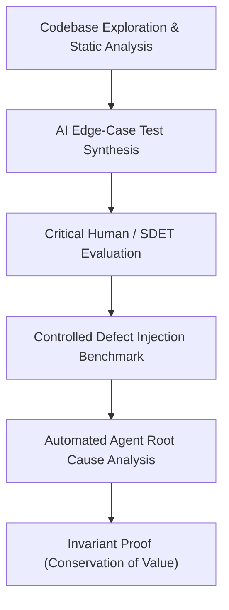

# AI-Assisted Financial QA Showcase & Case Study

**Platform**: FinanceFlow (Institutional Invoice Factoring & Reconciliation)  
**Target Audience**: Fintech Technical Leadership & Senior SDET / QA Architect Panels (Olea)  
**Author**: Phani Ranjan  
**Theme**: Deploying AI Coding Agents for Financial Systems Hardening without Blind Trust  

---

## 1. Executive Summary

In institutional trade finance and receivables factoring platforms, defect tolerance is zero. A single rounding defect, un-serialized concurrent disbursement, or premature reserve release can violate banking covenants and result in direct financial leakage.

This case study demonstrates how we utilized **Agentic AI Coding Assistants** as high-leverage SDET force multipliers throughout **Cycle 7 (System Hardening & Quality Engineering)**. Rather than treating AI as an autonomous decision-maker, we implemented an **Invariant-Driven Verification Harness** where all agent-generated code, tests, and diagnoses are strictly governed by double-entry accounting laws and database transaction semantics.

---

## 2. The AI-Augmented QA Methodology

### Core Tenets of the Approach:
1. **Never Blindly Trust Agent Outputs**:
   - AI models frequently suffer from *tautological test generation* (generating tests that simply assert whatever the current implementation does, even if buggy).
   - All tests must be anchored to immutable domain invariants (e.g., $\sum \text{Debits} \equiv \sum \text{Credits}$, $\text{Collateral} \equiv \text{Approved} + \text{Reserve}$).
2. **Deterministic Financial Arithmetic**:
   - Zero tolerance for binary floating-point (`float`). All amounts, fees, and rates use Python `Decimal` with explicit Bankers' / `ROUND_HALF_UP` quantization.
3. **Pessimistic Concurrency**:
   - Financial state changes must serialize via row-level locks (`SELECT ... FOR UPDATE`) in PostgreSQL, preventing race conditions before downstream payment providers are contacted.

---

## 3. Deliberate Defect Injection & Automated Diagnosis Case Study

To stress-test our AI-assisted QA capability, we engineered a controlled benchmark defect into the disbursement engine.

### The Injected Defect: Downstream Provider Unhandled Exception & Orphaned State
- **Symptom**: If the external payment rails gateway raised an unexpected network timeout (`httpx.TimeoutException` or `ConnectionResetError`), the system propagated an unhandled 500 error.
- **The Financial Risk**:
  - The financing application was left in an ambiguous state without an audit trail.
  - The caller received an uninformative crash rather than an actionable `502 Bad Gateway`.
  - In a retry scenario, duplicate disbursements could be triggered.

### The Agent's Diagnostic Workflow:
1. **Detection**:
   The AI agent ran the newly synthesized reliability suite (`test_concurrency_and_reliability.py`), which immediately failed with an unhandled `ConnectionResetError`.
2. **Root Cause Isolation**:
   The agent inspected `src/financeflow/services/disbursement.py` line 101, noting that `self._provider.disburse(provider_req)` was invoked outside a `try...except` boundary.
3. **Invariant Preservation & Patch**:
   - The agent wrapped the network call in a resilient exception handler.
   - It recorded a persistent `FinancingAuditLog` entry detailing the downstream failure reason.
   - It re-raised a mapped domain exception `DisbursementExecutionError`, enabling FastAPI to return an RFC 7807-compliant `502 Bad Gateway`.
4. **Verification**:
   The test was re-executed: green across both unit mocks and PostgreSQL integration containers.

---

## 4. Financial Invariants Matrix

Every test in the FinanceFlow QA suite validates one or more core mathematical invariants:

| Invariant Name | Mathematical Definition | Test Guard |
| :--- | :--- | :--- |
| **Collateral Conservation** | $\text{Collateral Pledged} = \text{Approved Principal} + \text{Customer Reserve}$ | `test_invariant_conservation_of_principal_and_reserve` |
| **Disbursement Value Conservation** | $\text{Approved Principal} = \text{Net Payout} + \text{Factoring Fee}$ | `test_invariant_fee_and_net_disbursement_integrity` |
| **Zero-Sum Trial Balance** | $\sum \text{Ledger Debits} - \sum \text{Ledger Credits} = 0.00$ | `test_complete_factoring_lifecycle_and_ledger_zeroing` |
| **Monotonic Collection Cap** | $\sum \text{Debtor Repayments} \le \text{Total Invoice Obligation}$ | `test_detect_deliberate_overpayment_shortfall_boundary` |
| **Idempotency Singularity** | $f(K, P) = f(K, P); \quad f(K, P') \to \text{Conflict (409)}$ | `test_disbursement_rejects_idempotency_key_payload_mismatch` |

---

## 5. Key Lessons Learned for Interview Discussion

1. **How to evaluate AI-generated tests**:
   - Check if the test asserts business reality or just mirrors the current code.
   - Test the tests (mutation testing or boundary injection). If flipping a `+` to `-` doesn't break the test, the test is useless.
2. **Handling race conditions in financial APIs**:
   - Idempotency keys prevent duplicate submission from the client.
   - `SELECT ... FOR UPDATE` row locks prevent simultaneous processing across multiple worker threads.
   - Database unique constraints (`UNIQUE INDEX`) serve as the final immutable backstop.
3. **CI/CD Pipeline Separation**:
   - Fast unit tests (~5s) give developers immediate feedback on PRs without spinning up Docker services.
   - Database integration tests (~30s) run in parallel against real PostgreSQL containers with health checks, enforcing 100% statement coverage.
